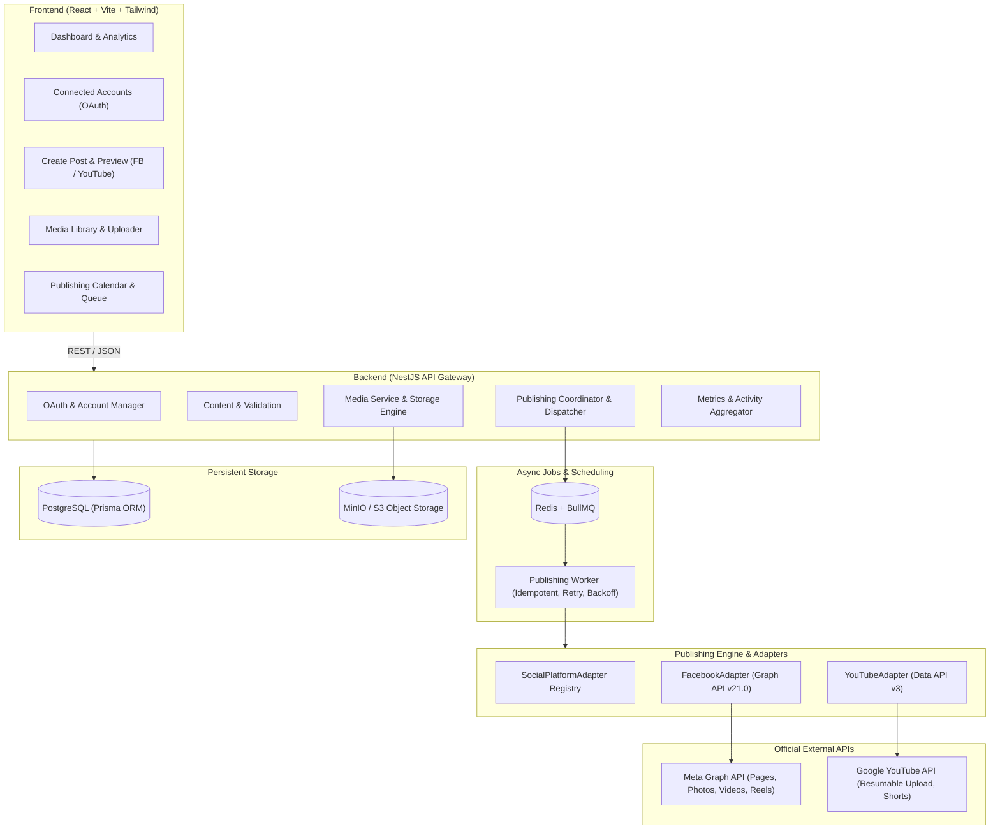
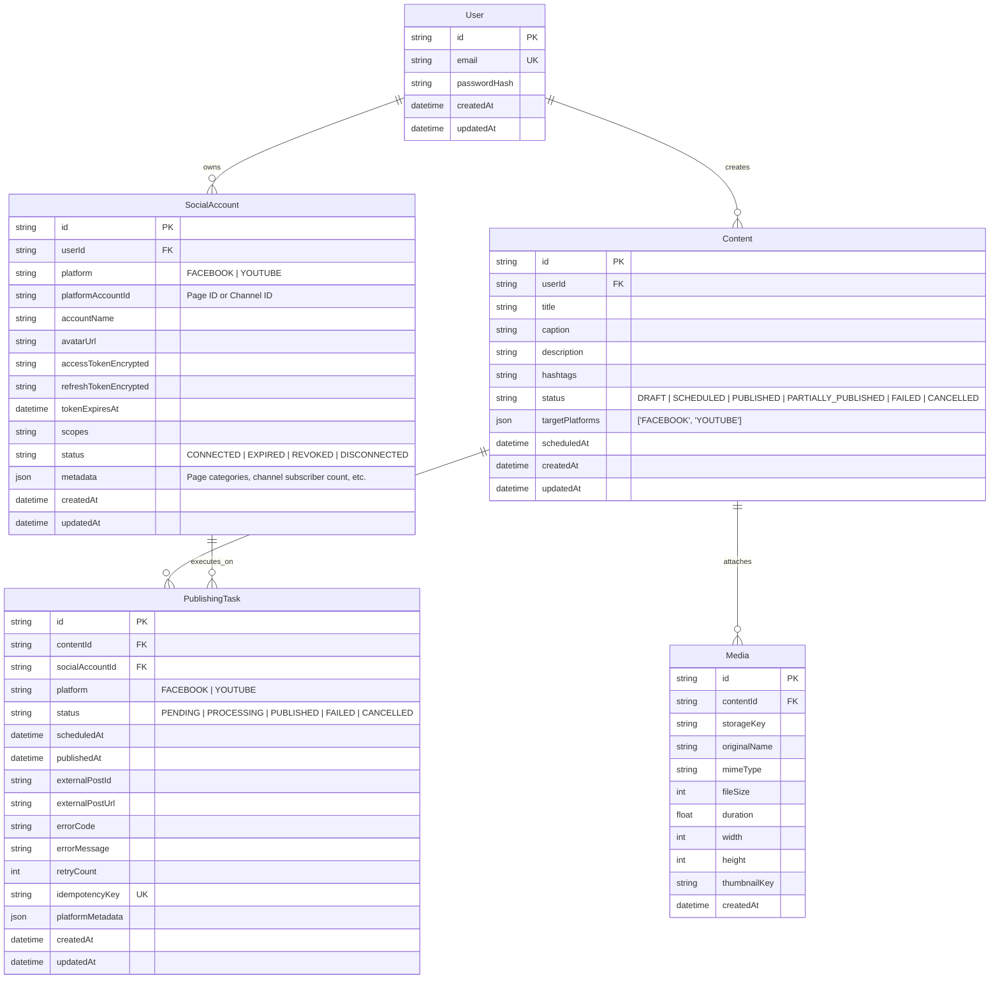
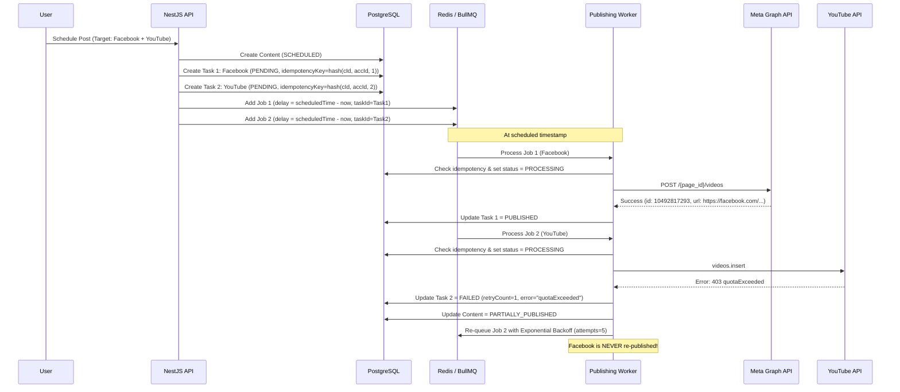

# Social Media Auto Publishing Module - Architecture & Implementation Plan

## 1. System Overview

The **Social Media Auto Publishing Module** is an enterprise-grade, production-ready system for multi-platform social media management, content creation, media asset processing, intelligent scheduling, and automated publishing to **Facebook Pages** (via Meta Graph API v21.0) and **YouTube Channels** (via YouTube Data API v3).

---

## 2. Technology Stack & Key Libraries

| Component | Technology | Rationale |
|---|---|---|
| **Backend Framework** | NestJS (TypeScript) | Modular, clean architecture, dependency injection, enterprise-standard |
| **ORM & Database** | Prisma ORM + PostgreSQL | Strongly typed database client, safe migrations, JSON support, connection pooling |
| **Job Queue & Scheduling** | BullMQ + Redis | Atomic job locking, delayed job scheduling, exponential backoff, persistent across restarts |
| **Object Storage** | MinIO / AWS S3 SDK v3 | S3-compatible, multipart upload, pre-signed URLs, local Docker development |
| **Video & Media Processing** | fluent-ffmpeg / Sharp | Video duration/dimension detection, thumbnail generation, MIME verification |
| **Frontend Framework** | React 18 + Vite + TypeScript | Blazing fast build, strong typing, clean component hierarchy |
| **UI & Styling** | Tailwind CSS + Lucide Icons | Responsive modern SaaS design system |
| **Data Fetching & State** | TanStack Query v5 + Axios | Server-state caching, background revalidation, optimistic updates |

---

## 3. Database Schema (Prisma Entity Relationship)

---

## 4. Platform Adapter Specifications

### A. Facebook Adapter (Meta Graph API v21.0)
- **Token Handling**: Long-lived Page Access Token exchanged from User Token via `fb_exchange_token`.
- **Text Post**: `POST /{page_id}/feed` -> body `{ message }`.
- **Photo Post**: `POST /{page_id}/photos` -> multipart upload or S3 public/presigned URL with `caption`.
- **Video Post & Reels**:
  - Regular video: `POST /{page_id}/videos` with `description` and `title`.
  - Reels workflow: `POST /{page_id}/video_reels` (Init session -> Upload binary chunks -> Finish/Publish).
- **Error Mapping**: Decodes Graph API error code & `error_subcode` (e.g. 190 = token expired, 200 = permission missing).

### B. YouTube Adapter (YouTube Data API v3)
- **Token Handling**: Google OAuth2 client with `access_type=offline`, automatic refresh via `refreshToken`.
- **Video Upload**: Resumable upload protocol (`POST https://www.googleapis.com/upload/youtube/v3/videos?uploadType=resumable&part=snippet,status`).
- **Metadata**: Title (<= 100 chars), Description (<= 5000 chars), Tags array, Category ID (default 22: People & Blogs), Privacy (`public`, `unlisted`, `private`).
- **Shorts Detection**: Vertical video (aspect ratio 9:16) with duration <= 60s is tagged with `#Shorts` for automatic Shorts shelf placement.
- **Scheduled Publishing**: Supports `status.publishAt` in RFC 3339 format when `status.privacyStatus = 'private'`.

---

## 5. Idempotent Scheduling & Partial Publishing Workflow

